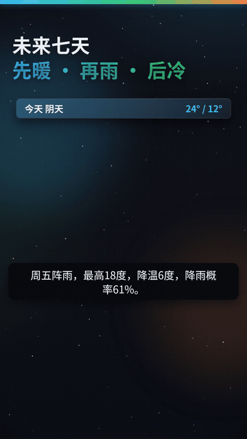
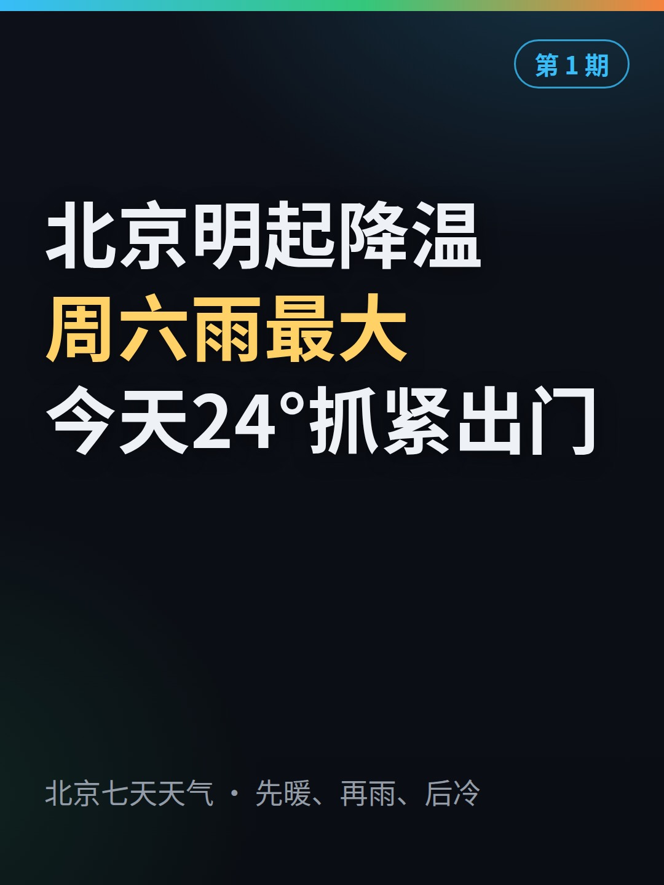

<p align="center">
  
</p>

<h1 align="center">小红书全自动化运营发布（适配muse、Chatgpt dots、Grok bots）</h1>

<p align="center">让云端 AI 智能助手替你运营小红书：搜资讯、写稿、做视频、发布、跟评论，一条龙全自动。</p>

<p align="center">
  
  
  
</p>

<p align="center">中文 | <a href="README.en.md">English</a> · <a href="https://auto-xhs.tiybai.com">详细介绍页</a></p>

仓库名：Auto-xhs

## 这个项目是干什么的

你把自己的小红书号，在智能助手自己的浏览器里登录一次，剩下的事它全包：每天自己去搜资讯、整合成稿、做成视频、发出去、跟评论。能干这活的助手有三家——Muse、Dots（OpenAI 的）、Grok Bot（xAI 的），三个都是云端 agent，各有自己的一台云端电脑和浏览器。全程在浏览器里像人一样点、一样打字，不用任何非官方接口，发帖频率也是正常人的频率。

解决的就是一件事：做小红书最耗时间的，是搜资讯、整理、做视频、发布、回评论这一整条链。这个项目把这一条龙全自动了，你要做的只有三件：选个方向、扫一次码、（用半自动的话）发布前看一眼。

**我们的宗旨：免费、安全防封、高效、简单。**

先把实话说在前面：防封靠的是模拟真人操作加上正常频率，不是对任何账号打包票。平台对全自动托管一直查得严，所以我们推荐新号先用半自动，发布前自己看一眼。细的写在 [docs/compliance.md](docs/compliance.md) 里。

## 先看效果

这是系统自己做的一条天气预报，就是仓库里那个官方示例玩法包：数据从免费的 Open-Meteo 现取，稿子、配音、画面全自动生成，验收六项全过。按要求只做到待发包，没有真的发布。

<p align="center">
  
  
</p>

左边是成片里的动效画面，右边是它的封面。

## 视频是怎么做出来的

视频是拿网页做的，这也是这个项目最不一样的地方。

每条视频先写成一个网页：用 HTML 和 CSS 排版面，用 GSAP 排动画，好看的动效都放在一个现成的动效库里，写稿的时候直接调。然后用浏览器把动画停住，一帧一帧截图，一秒 30 张。最后用 ffmpeg 把图串成视频，合上配音，加到 1.5 倍速。

为什么这么做：网页排版做卡片、图表、价格对比，又快又好看，改一个数字不用重剪视频；一帧一帧截图，动画在第几秒什么样是定死的，不会这次跑一个样、下次跑一个样。

## 三家助手，差别先说清

规矩、验收标准、待发包的格式，三家用的都是同一份。三家也都是云端 agent，差别只在两处：发布那一下先问不问你、你现在能不能用上。Muse 这条已经有号在日更，实测过；Dots 和 Grok Bot 两列是按官方口径写的，还没实测。

| 能力 | Muse | Dots | Grok Bot |
|---|---|---|---|
| 搜资讯、写稿 | 能 | 能 | 能 |
| 做视频 | 能 | 能，在它自己的云端电脑里跑 | 能，在云端虚拟机里跑 |
| 一步一步分工干活 | 最顺，现成 | 能，能派子 agent | 能，能派子 agent |
| 每天定时自己开工 | 能 | 能，自带定时 | 能，自带定时 |
| 在浏览器里自动发布 | 能 | 能，先问还是放行看你定的规则 | 能，先问还是放行看你怎么设，默认先等你批准 |
| 发后回评论 | 能 | 能，靠定时 | 能，靠定时 |
| 每周复盘 | 能 | 能，靠定时 | 能，靠定时 |

细表在 [docs/capability-matrix.md](docs/capability-matrix.md)。你现在用哪家，就看哪家的说明：[Muse](adapters/claude/README.md)、[Dots](adapters/dots/README.md)、[Grok Bot](adapters/grok/README.md)。

## 最省事的装法

把下面这段话，连同这个仓库的地址，一起复制给你的智能助手，它会自己把环境备好，再带你一项一项设置：

```
帮我把 auto-xhs 装好，照着仓库里的说明来：
1. 先跑 bash scripts/setup.sh，它会查环境、下第三方库、备好配置文件。缺什么你告诉我，我来装。
2. 然后打开 SETUP.md，带我一项一项填 config.yaml。第一项先让我在全自动、半自动、手动三档里选一档，把三档的区别讲清，推荐我先用半自动，但别替我定。
3. 填到小红书登录那一步停住，告诉我怎么扫码，我自己扫，别碰我的密码和验证码。
4. 都填完，拿 examples 里的示例跑一遍验收给我看，再跑第一条。第一条做到发布前停住，等我看过再发。
```

手动装也行，顺序是：`bash scripts/setup.sh`，然后照 [SETUP.md](SETUP.md) 填 `config.yaml`。

## 每天它是怎么干活的

有个总管负责派活和验收，干活的一个一个来，上一步验收过了才做下一步：

1. **选题**：把信源扫一遍，48 小时内的新东西里挑一个，跟昨天品类错开。先过敏感清单，沾上的直接不要。关键事实要有官方说法，再找一个不相干的来源对上。
2. **写稿**：标题先写 3 版选一个。口播稿 480 到 650 字，开头先说跟看的人有什么关系，价格这种数字要算全，还要跟同类比一比。
3. **做片**：按稿子做网页、配音、逐帧截图、合成。产品图必须是这个产品本人的图，软件要露出真实界面，不能拿一张标志图糊弄。
4. **验收**：跑 `core/validate.py`，字数、时长、分辨率、静音、封面、期号，一项一项查。做片的人自己填的验收单，总管还要再核一遍。有一项不过，就打回重做。
5. **发布**：从小红书主站进去（不要直接开创作者平台的网址），发之前把话题一个一个点成蓝色的，数量对上才许发，AI 内容声明要选。发完马上用号主身份发第一条评论。
6. **跟进和复盘**：发后 2 小时内，每半小时看一眼有没有新评论，有就回。周末复盘一次，把这周学到的东西写回规矩里。

每一步做完都要留下证据：文件在哪、数字是多少、查了哪几项。说不出来源的「做好了」不算数。细的在 [orchestration/orchestrator.md](orchestration/orchestrator.md)。

## 仓库里都有什么

- [core/](core/)：全部规矩，只此一份。宪法页定总的口径，六份阶段手册写每一步怎么做，另有敏感词表模板和验收脚本。
- [motion-lib/](motion-lib/)：网页动效库。标题怎么入场、数字怎么滚动、卡片怎么翻，都在这。
- [pipeline/](pipeline/)：做片的脚本。逐帧截图、合成、封面模板、配音接法。
- [orchestration/](orchestration/)：总管怎么派活、定时任务怎么写、手动跑一轮的清单。
- [adapters/](adapters/)：三家助手各自怎么接进来。
- [examples/](examples/)：一条完整的虚构示例，从选题到验收单，照着它就知道每一步的产出长什么样。
- [docs/](docs/)：结构说明、三家细对比、合规提醒、常见问题。

## 花钱吗

不花。做视频的库、合成工具、配音，两条路都是免费的。要花的只有你那个智能助手账号本身的钱，那是你跟它之间的事，这个项目不接任何要付费的接口。

## 欢迎一起加新用途

这套东西不只能发科技资讯。搜资讯、整合、做视频、发布、运营这条链是通用的，换个方向就能发别的东西：每天发天气预报、发一段治愈小动画、发本地生活提醒，都行。你做出了新用途，欢迎加回来，让这个库越来越丰富。

新用途有现成的加法：一个用途做成一个「玩法包」，格式都定好了，照着 [scenarios/_template/](scenarios/_template/) 填就行。天气预报就是照这个格式做出来的例子，在 [scenarios/weather-forecast/](scenarios/weather-forecast/)。全部玩法列在 [scenarios/README.md](scenarios/README.md) 的清单里，老用户回来找新功能，先看那张表。

也欢迎二次开发到别的平台：选题、写稿、做片、验收都是通用的，一份素材可以改成好几个平台的待发包，小红书发一份，抖音再发一份。要交的东西列在 [docs/platform-targets.md](docs/platform-targets.md) 里，抖音那一节接口已经留好，还没实测，欢迎来补。

想加玩法、求个新玩法、或者改通用规矩，先看 [CONTRIBUTING.md](CONTRIBUTING.md)，一页写完了。

## 许可证

MIT。随便用，保留版权声明就行。第三方库各有各的许可证，列在 [motion-lib/vendor/README.md](motion-lib/vendor/README.md)。
